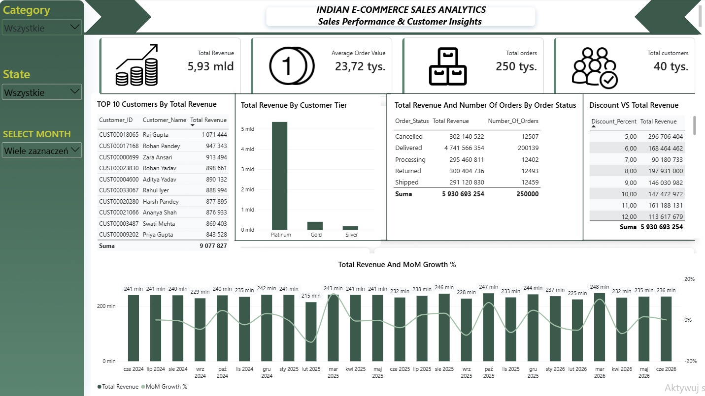

# Indian E-Commerce Sales Analytics | SQL Server + Power BI

**Portfolio project — Junior Data Analyst**  
**Jakub Słowiński**  
**Stack:** T-SQL (SQL Server), Power BI, model relacyjny  
**Zakres dat:** 01.06.2024–30.06.2026 (25 pełnych miesięcy)

> Analiza publicznego, syntetycznego zbioru danych e-commerce. Cel: ocena sprzedaży, struktury klientów, kategorii, rabatów i trendów miesięcznych oraz weryfikacja kluczowych KPI w SQL.



[**📄 Otwórz pełny raport portfolio (PDF)**](reports/ecommerce_portfolio_report.pdf) · [**🔎 Analiza SQL**](sql/01_business_analysis.sql) · [**✅ Walidacja KPI i MoM w T-SQL**](sql/02_powerbi_validation.sql)

## Cel biznesowy

Zbudować czytelny dashboard wspierający analizę wyników sprzedaży i odpowiedzieć na pytania:
- Które kategorie oraz segmenty klientów generują największą część wartości zamówień?
- Jak zmieniają się przychód transakcyjny, liczba zamówień i AOV miesiąc do miesiąca?
- Jak rozkładają się wartości zamówień według statusu i kuponu?
- Czy agregacje Power BI są zgodne z niezależnymi zapytaniami SQL?

## Główne KPI

| Miara | Wynik | Definicja |
| --- | ---: | --- |
| Wartość zamówień (`Total_Amount`) | **5 930 693 254,30** | Suma wszystkich statusów zamówień |
| Average Order Value (AOV) | **23 722,77** | `SUM(Total_Amount) / DISTINCTCOUNT(Order_ID)` |
| Zamówienia | **250 000** | Unikalne `Order_ID` w `Sales` |
| Klienci z zamówieniem | **39 914** | Unikalne `Customer_ID` w `Sales` |
| Przychód MoM, czerwiec 2026 | **+0,08%** | Czerwiec vs maj 2026 |

**Ważna definicja:** tutaj „przychód” w dashboardzie oznacza **sumę pola `Total_Amount`**, także dla zamówień anulowanych i zwróconych. Nie jest to księgowy przychód zrealizowanej sprzedaży. Dla statusu **Delivered** suma `Total_Amount` wynosi ok. **4,74 mld**. Wartości pieniężne podano w jednostkach źródła — bez samodzielnego przeliczenia na PLN.

## Model danych

```text
Customers (40 000 wierszy)                 Products (2 000 wierszy)
 PK Customer_ID                              PK Product_ID
           | 1                                    | 1
           |                                      |
           | *                                    | *
           +------------- Sales ------------------+
                        (250 000 wierszy)
                        PK Order_ID
                        FK Customer_ID
                        FK Product_ID
```

Tabela faktów **Sales** łączy się relacjami **1:* (jeden do wielu)** z wymiarami **Customers** i **Products**. Jeden wiersz `Sales` reprezentuje jedno zamówienie powiązane z jednym produktem i klientem w tym zbiorze.

## Przebieg analizy

1. Import `sales.csv`, `customers.csv`, `products.csv` do tabel stagingowych SQL Server.
2. Kontrola liczby rekordów, unikalności identyfikatorów, powiązań FK, typów, braków i nietypowych wartości.
3. Przeniesienie oczyszczonych danych do modelu relacyjnego z tabelami `dbo.Sales`, `dbo.Customers`, `dbo.Products`.
4. Budowa modelu oraz interaktywnego dashboardu w Power BI.
5. Niezależne przeliczenie przychodu, liczby zamówień, aktywnych klientów, AOV i trendu MoM w T-SQL.
6. Interpretacja wyników z rozdzieleniem **faktów** od **hipotez do dalszej weryfikacji**.

**Kontrola jakości:** nie stwierdzono duplikatów kluczy głównych ani niedopasowanych powiązań w kluczowych tabelach. Kolumna `Rating` ma **129 970 pustych wartości (52,0% zamówień)**. W `Total_Amount` jest **5 rekordów ujemnych**, wszystkie z kuponem `DIWALI100`. W modelu jest 40 000 klientów, lecz 86 nie ma zamówienia w badanym okresie.

## Najważniejsze wnioski

| Obszar | Fakt potwierdzony obliczeniami | Hipoteza / dalszy krok |
| --- | --- | --- |
| Kategorie | **Electronics**: 72,61% wartości zamówień, przy 26,71% ich liczby; AOV kategorii: 64 482,73 | Sprawdzić, jak zmiana udziału Electronics wpływa na ogólne AOV |
| Klienci | **Platinum**: 90,08% wartości zamówień, 68,52% klientów z zamówieniem | Porównać segmenty przy podobnym stażu klienta |
| Kupony | Kupon użyty w **50 185 zamówieniach (20,07%)**; `SAVE10` w 24 997 | Wpływ kuponów na ponowne zakupy wymaga porównania podobnych grup |
| Trendy | W lutym 2025 i 2026 miesięczna liczba zamówień spadła o ok. 9–10%; po korekcie o liczbę dni: od −0,44% do +1,16% | Analizować porównania rok do roku na danych dziennych i według kategorii |
| Ostatni miesiąc | Czerwiec 2026: przychód **+0,08% MoM**, zamówienia **−1,23% MoM**, AOV **+1,33% MoM** | Ocenić, czy za zmianę AOV odpowiada miks kategorii |

Szczegółowe wyliczenia, wykresy oraz ograniczenia interpretacji znajdują się w [raporcie PDF](reports/ecommerce_portfolio_report.pdf).

## Walidacja SQL ↔ Power BI

W zapytaniach walidacyjnych porównuję te same **daty, statusy zamówień i definicje miar**. Przychód i AOV zgadzają się do dwóch miejsc po przecinku, a liczby zamówień i klientów są identyczne. Trend MoM w SQL jest liczony z miesięcznych agregatów za pomocą `LAG()`.

Przykład kontroli: **maj 2026 — 235 484 942,44**, **czerwiec 2026 — 235 684 585,33**, co daje ok. **+0,08% MoM**.

- [Kontrole danych stagingowych](sql/00_data_quality_checks.sql)
- [Zapytania biznesowe](sql/01_business_analysis.sql)
- [Walidacja KPI i MoM](sql/02_powerbi_validation.sql)

## Pliki w repozytorium

```text
ecommerce-sales-analysis-sql-powerbi/
├── README.md
├── assets/
│   └── dashboard.png
├── data/
│   └── README.md
├── powerbi/
│   └── README.md
├── reports/
│   └── ecommerce_portfolio_report.pdf
└── sql/
    ├── 00_data_quality_checks.sql
    ├── 01_business_analysis.sql
    ├── 02_powerbi_validation.sql
    └── README.md
```

## Jak odtworzyć analizy

1. Pobierz od autora danych na **Kaggle** zbiór *Indian E-Commerce Sales Analytics Dataset* (Jatin Khandelwal); źródłowe pliki to `sales.csv`, `customers.csv`, `products.csv`.
2. W SQL Server zaimportuj CSV do tabel stagingowych, a następnie przygotuj docelowe tabele z właściwymi typami i kluczami według schematu powyżej. **Skrypty tworzenia i pełnego importu bazy nie są dołączone** — repozytorium zawiera zapytania kontrolne i analityczne, a nie gotowy automatyczny pipeline instalacyjny.
3. Uruchom kontrolę danych `sql/00_data_quality_checks.sql` na tabelach stagingowych.
4. Po utworzeniu tabel `dbo.Sales`, `dbo.Customers` i `dbo.Products` uruchom pozostałe zapytania.
5. Porównaj rezultaty z definicjami KPI i z raportem PDF.

**Power BI:** plik źródłowy raportu jest w katalogu [`powerbi/`](powerbi/), a zrzut dashboardu w `assets/dashboard.png`. Otwórz plik `.pbix` w Power BI Desktop, żeby zobaczyć model danych, miary DAX i interakcje.

## Źródło i ograniczenia

- Źródło: **Jatin Khandelwal — *Indian E-Commerce Sales Analytics Dataset*, Kaggle**; dane syntetyczne/publiczne, wykorzystywane do projektu edukacyjnego.
- Dataset i materiały analityczne nie są rzeczywistym raportowaniem sklepu ani podstawą wnioskowania przyczynowego.
- Brakujące oceny i ujemne zamówienia wymagają ostrożności przy interpretacji.
- Nie dołączam surowych CSV ani danych kontaktowych klientów; należy je pobrać samodzielnie z oryginalnego źródła.
- SQL oparto na oryginalnych zapytaniach projektowych oraz logice walidacji opisanej w raporcie; kod uporządkowano do publikacji. Wersja repozytoryjna **nie była ponownie uruchamiana na bazie w tym środowisku**.

---
*Projekt portfolio: SQL Server + Power BI • Junior Data Analyst*
